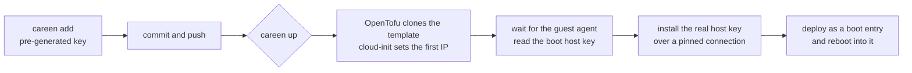

# Provisioning on Proxmox

careen can create the machines themselves. A host with `provisioner = "proxmox"` in its fleet
entry gets a VM on a Proxmox cluster, declared in the flake next to its NixOS configuration.
`careen up` creates it, installs its host key and deploys it.

Hosts with the default `provisioner = "existing"` are machines that are already there; `up`
just deploys them.

## What the flake provides

Two more outputs, usually generated from a per-host option (say, `pve`) set next to each host's configuration:

- **`pve`**: the VM inventory careen reads.
- **`pve-tofu`** (a package): that inventory rendered to OpenTofu JSON for the
  [bpg/proxmox](https://registry.terraform.io/providers/bpg/proxmox/latest) provider. careen runs
  the flake's own `opentofu` package against it, so the provider version is pinned by your flake.

!!! info "What careen expects from the flake"
    These names are careen's interface; your flake decides how to build them.

    | Output | What |
    | --- | --- |
    | `pve` | The VM inventory, below. |
    | `packages.<system>.pve-tofu` | That inventory rendered to OpenTofu JSON (`main.tf.json`). |
    | `packages.<system>.opentofu` | OpenTofu with the bpg/proxmox provider built in, so `tofu init` needs no registry. |
    | `nixosConfigurations.<templateHost>` | The generic host every VM is cloned from (`templateHost`, default `pve-base`), built as `system.build.images.proxmox`. |

careen never changes hardware through the Proxmox API itself: OpenTofu does. careen uses the API
only to wait for a new VM's guest agent and read its host key, and SSH (as root) to the Proxmox
nodes for templates and restarts.

### The `pve` output

```nix
pve = {
  endpoint = "https://10.0.0.11:8006/";
  storage = "local-lvm";
  templateHost = "pve-base";
  nodes = {
    pve1 = { address = "10.0.0.11"; template = 9000; };
    pve2 = { address = "10.0.0.12"; template = 9001; };
  };
  token = { file = "secrets/pve/secrets.yaml"; key = "proxmox_api_token"; };
  hosts = {
    # plus cores, memory, disks, NIC and first-boot IP, for pve-tofu
    node1 = { node = "pve1"; vmid = 131; };
  };
};
```

| Setting | Meaning |
| --- | --- |
| `endpoint` | The Proxmox API URL; any node serves the whole cluster. |
| `storage` | Default storage for VM disks. |
| `templateHost` | The flake host whose Proxmox image every VM is cloned from (default `pve-base`). |
| `nodes` | Each Proxmox node: `address`, where careen SSHes as root, and `template`, the VM ID of that node's template. |
| `token` | Where the API token is in sops: `file` (relative to the flake) and `key`. Encrypt it to the master key only. |
| `hosts` | Each VM: the `node` it runs on and its `vmid`, plus everything `pve-tofu` renders (cores, memory, disks, network, cloud-init IP). Optionally `guestAgent`, true when the host's own NixOS config runs `qemu-guest-agent` (see [Without a guest agent](#without-a-guest-agent)). |

**careen never lets OpenTofu reboot a VM.** Next to the rendered config it writes an OpenTofu
override file, `careen_override.tf.json`, that sets `reboot_after_update = false` on every VM,
whatever your config says. Applying a change therefore never reboots a running VM behind your
back; changes that need a restart wait as pending, and careen restarts VMs itself, one at a time
and per `rebootPolicy` (see [Reboots](reboots.md#proxmox-hardware-changes)). Setting it in your
config too is harmless and documents the intent.

## Templates

Every VM is a full clone of one generic NixOS image, built from `templateHost`:

```console
$ careen template build                      # build the image, install it on every node
$ careen template build --node pve1 --replace
```

The image is built once, then restored on each node as that node's template VM. A node that
already has its template keeps it unless `--replace`. Clones are full copies, so replacing a
template never affects existing VMs. Rebuild after a NixOS release bump, or when the base image
changes in a way new VMs need, such as its boot order.

## Bringing hosts up

```console
$ careen add node1 --yes        # pre-generates the host's SSH key (see Onboarding)
$ careen vm plan --tag cluster  # what would be created or changed
$ careen up --tag cluster       # create, key and deploy, one host at a time
```



For each host, `careen up`:

1. asks the provisioner for a running machine; for Proxmox, OpenTofu applies the host's plan
   (refusing one that would replace an existing VM), then careen waits for the QEMU guest agent
   and reads the VM's host key through it;
2. installs the host's pre-generated key over an SSH connection pinned to the key the VM booted
   with, so there's no trust-on-first-use;
3. deploys the host; a first deploy over the generic image goes in as a boot entry, and the host
   reboots into it.

Every step is skipped when already done, so rerunning `careen up` after a failure continues where
it stopped.

`careen up` also says which commit a remote flake reference (no explicit revision) resolved to,
and with `--repo` or `CAREEN_REPO` set warns when your checkout has commits that commit lacks,
since careen builds what the remote has. Each step of a host says how long it took, and
`--timings` ends the run (or `--plan`) with a list of the steps and of every `nix`, `tofu` and `ssh`
command that took over a tenth of a second (repeats added up), to show where a slow `up` went.

### Without a guest agent

A new VM boots the generic image, which has the agent, so careen always waits for it (up to ten
minutes, saying every 15 seconds how long is left). A VM that already exists runs its own system,
and a deploy from a flake that doesn't enable `services.qemuGuest` removes the agent. Waiting for
an agent nothing can start would never end, so for an existing VM:

- If `hosts.<name>.guestAgent` is `false`, or you pass `--no-agent-wait`, careen doesn't wait. It
  says so, warns that Proxmox can't show the VM's IP without the agent, and uses the address from
  the inventory.
- Otherwise (`true`, or a flake that doesn't set it) it waits one minute. If the agent still
  doesn't answer, careen looks over SSH. A system without the agent unit is reported and the
  deploy continues, since the deploy is the fix. A stopped unit is started.

The agent is also how careen learns a VM's host key without trusting the network. Without it,
careen accepts only a key it already knows: the host's pre-generated key in the repository or its
`known_hosts` entry. If sshd serves another key, or SSH is unreachable, `careen up` stops with an
error rather than trust whatever answers.

## Tearing down

```console
$ careen down --only node2
$ careen down --tag cluster --yes
```

destroys the VMs and their disks and forgets their `known_hosts` entries. The hosts'
configuration, pre-generated keys and secrets stay in the repository, so `careen up` recreates the
same hosts with no sops changes. Hosts careen didn't provision are refused.

!!! warning "Retire a host before removing it"
    careen only acts on hosts that are in the flake. Run `careen down` on a host **before** you
    remove it from the inventory; otherwise its VM is left behind, outside OpenTofu's state.

## Day 2: changing hardware

Change the host's VM settings in the flake, then:

```console
$ careen vm plan --only node1   # shows the change
$ careen vm apply --only node1  # applies it, without deploying or rebooting
$ careen reboot --only node1    # restarts it through Proxmox if the change needs that
```

`careen up` also applies pending hardware changes before deploying. Never change a managed VM in
the Proxmox UI or with `qm set`: the next apply reverts it.

## State and credentials

- **OpenTofu state** lives in `$XDG_STATE_HOME/careen/pve` (`~/.local/state/careen/pve`) on the
  machine careen runs on. Keep that machine backed up; moving state to an S3 backend is on the
  [Roadmap](../roadmap.md). The state is per machine, not per flake: every flake careen manages
  there shares it, keyed by host name. careen only ever plans the hosts it's acting on, and refuses
  to delete a VM whose VM ID or node differs from what the flake declares, so another flake's
  same-named host is safe; still, to keep a second fleet (a test flake, a tutorial) fully apart,
  give it its own `XDG_STATE_HOME`.
- **The API token** is decrypted from sops with the master key when a command needs it and is
  only ever passed to `tofu` in its environment. Commands that don't touch VMs never decrypt it.
