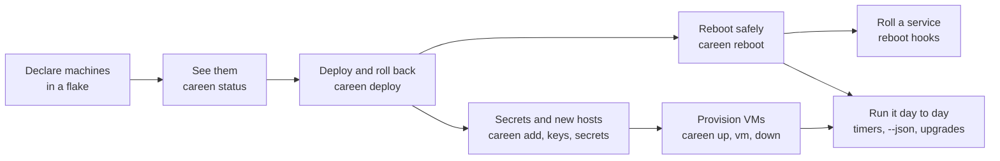

# Tutorials

Worked examples you can copy and run. Each one is a real flake in careen's
[`examples/`](https://github.com/ryanmwright/careen/tree/main/examples) directory, starts from a flake
template, and is checked by CI, so the commands on these pages keep working.

| Tutorial | You'll learn | Needs |
| --- | --- | --- |
| [Your first fleet](first-fleet.md) | Declaring a machine, `status`, `deploy`, `rollback`, `reboot`, the TUI | Linux with KVM and Nix |
| [Rolling reboots behind a load balancer](rolling-reboots.md) | `rebootOrder`, `pre`/`post`/`gate` hooks on another host, answering a drain that times out (terminal, `--json`, TUI) | The same, three VMs |
| [Onboarding hosts and secrets](secrets.md) | A master key, registering hosts' keys, `secrets set`, `careen add` from a template, a reinstalled host | The same, two VMs |
| [Provisioning VMs on Proxmox](proxmox.md) | The `pve` inventory, OpenTofu from stock nixpkgs, `template build`, `up`, `vm apply`, `down` | A Proxmox cluster |
| [Running a fleet day to day](operating.md) | The whole loop: watching, changing, patching, automating, adding and retiring machines, release upgrades, backups | Any of the above |

The examples use made-up names (`web1`, `admin`) and run as local VMs, so you can try careen without
touching a real machine; each tutorial ends with what changes for real hardware.
